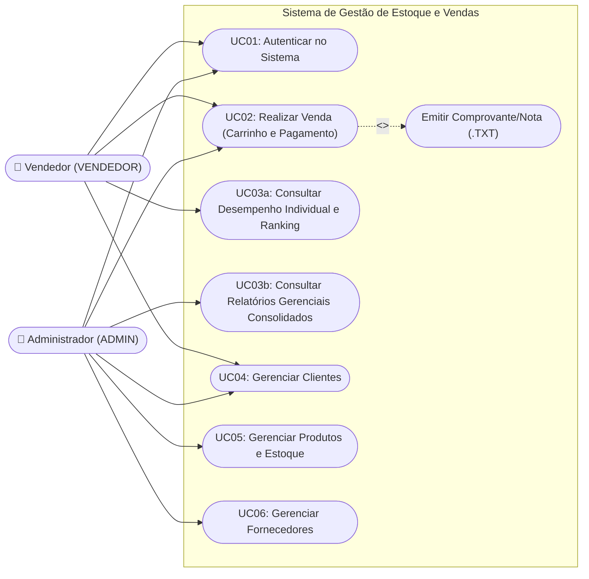

# 📋 Documentação de Requisitos e Casos de Uso
**Sistema de Gestão de Estoque e Vendas**

Este documento apresenta o levantamento de **Requisitos Funcionais (RF)** e a **Especificação de Casos de Uso (UC)** referentes aos perfis de usuários do sistema (`ADMIN` e `VENDEDOR`).

---

## 1. Requisitos Funcionais (RF)

| ID | Requisito Funcional | Descrição | Perfis Envolvidos |
| :--- | :--- | :--- | :--- |
| **RF01** | **Autenticação de Usuários** | O sistema deve permitir o login de usuários por meio de credenciais (usuário/senha), redirecionando para o painel correspondente ao perfil (`ADMIN` ou `VENDEDOR`). | Todos |
| **RF02** | **Controle de Acesso (RBAC)** | O sistema deve restringir telas e operações sensíveis, garantindo que vendedores acessem apenas seu desempenho individual e o ranking de vendas, enquanto administradores possuem acesso irrestrito. | Admin / Vendedor |
| **RF03** | **Gestão de Clientes** | O sistema deve permitir o cadastro, consulta e gerenciamento de clientes com informações como nome, CPF/CNPJ e telefone. | Admin / Vendedor |
| **RF04** | **Gestão de Produtos e Estoque** | O sistema deve permitir o cadastro de produtos, vínculo com fornecedores, controle de quantidade em estoque e emissão de alertas/relatórios de estoque baixo ($\le 5$ unidades). | Admin |
| **RF05** | **Gestão de Fornecedores** | O sistema deve permitir o cadastro e gerenciamento dos fornecedores vinculados aos produtos do estoque. | Admin |
| **RF06** | **Registro e Montagem de Vendas (Carrinho)** | O sistema deve permitir a seleção de cliente e vendedor, a adição de itens ao carrinho de compras com verificação de estoque, alteração de quantidades e exclusão de itens. | Admin / Vendedor |
| **RF07** | **Processamento de Pagamento** | O sistema deve permitir a seleção de métodos de pagamento (PIX, Débito, Crédito, Dinheiro) e a finalização da transação com atualização automática do estoque. | Admin / Vendedor |
| **RF08** | **Emissão de Comprovantes e Notas (.TXT)** | O sistema deve gerar e exibir o comprovante/cupom fiscal em formato texto (`.TXT`), permitindo cópia, impressão e download. | Admin / Vendedor |
| **RF09** | **Painel de Relatórios e Indicadores** | O sistema deve consolidar indicadores de faturamento anual/mensal, histórico de vendas e demonstrativos (como Informe de Rendimentos e produtos cadastrados) com restrições por perfil. | Admin / Vendedor |
| **RF10** | **Ranking de Vendedores** | O sistema deve exibir o Top 3 vendedores com base no volume de vendas acumuladas no ano corrente. | Admin / Vendedor |

---

## 2. Diagrama de Casos de Uso (Visão Geral de Usuários)

> **Nota para o GitHub:** O diagrama abaixo utiliza a sintaxe *Mermaid*, que é renderizada automaticamente como uma imagem gráfica pelo GitHub ao visualizar este arquivo.

---

## 3. Especificação Detalhada dos Casos de Uso

### Atores do Sistema
* **Administrador (`ADMIN`):** Gestor com privilégios totais sobre cadastros, estoque, relatórios gerais do sistema e auditoria de vendas.
* **Vendedor (`VENDEDOR`):** Operador responsável por registrar vendas, consultar/cadastrar clientes e acompanhar seu próprio desempenho e o ranking de vendas.

---

### UC01: Autenticar no Sistema
* **Ator Principal:** Administrador ou Vendedor.
* **Pré-condição:** O usuário deve estar previamente cadastrado na tabela `tb_usuario`.
* **Fluxo Principal:**
  1. O usuário acessa a página de login (`login.jsp`).
  2. Informa suas credenciais e submete o formulário.
  3. O sistema valida os dados e cria uma sessão ativa (`HttpSession`) contendo o objeto do usuário e seu respectivo perfil (`ADMIN` ou `VENDEDOR`).
  4. O sistema redireciona o usuário para o painel principal.

---

### UC02: Realizar Venda (Carrinho e Pagamento)
* **Ator Principal:** Administrador ou Vendedor.
* **Pré-condição:** O usuário deve estar autenticado no sistema.
* **Fluxo Principal:**
  1. O usuário acessa o módulo de Gestão de Vendas (`vendas.jsp`).
  2. Seleciona o cliente da venda.
  3. O sistema registra o vendedor responsável pela operação (bloqueando a troca indevida durante a operação).
  4. O usuário adiciona produtos disponíveis em estoque ao carrinho informando as quantidades desejadas.
  5. Aciona o botão **Forma de Pagamento** e seleciona o método (PIX, Crédito, Débito ou Dinheiro).
  6. Confirma a transação, acionando a baixa automática no estoque (`tb_produto`) e habilitando a opção de gerar o recibo em formato `.TXT`.

---

### UC03: Consultar Relatórios e Desempenho
* **Ator Principal:** Administrador ou Vendedor.
* **Pré-condição:** Estar autenticado e acessar a aba de Relatórios (`relatorios.jsp`).
* **Fluxo Principal — Visão do Vendedor (`VENDEDOR`):**
  1. O sistema verifica que o perfil não é administrativo (`admin == false`).
  2. Restringe os indicadores financeiros e o gráfico mensal exclusivamente às vendas vinculadas ao ID do vendedor logado.
  3. Exibe o **Ranking de Vendas (Top 3)** do ano corrente e o histórico de suas próprias vendas.
* **Fluxo Principal — Visão do Administrador (`ADMIN`):**
  1. O sistema verifica o perfil administrativo (`admin == true`).
  2. Exibe o painel consolidado de faturamento geral da empresa, gráficos anuais completos, alertas de produtos com estoque baixo e cartões para geração/download de relatórios gerenciais em `.TXT` (Produtos Cadastrados, Clientes Cadastrados, Estoque Baixo e Informe de Rendimentos).